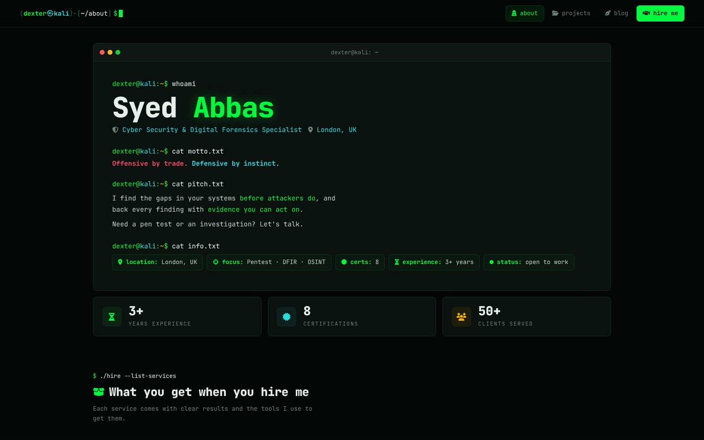
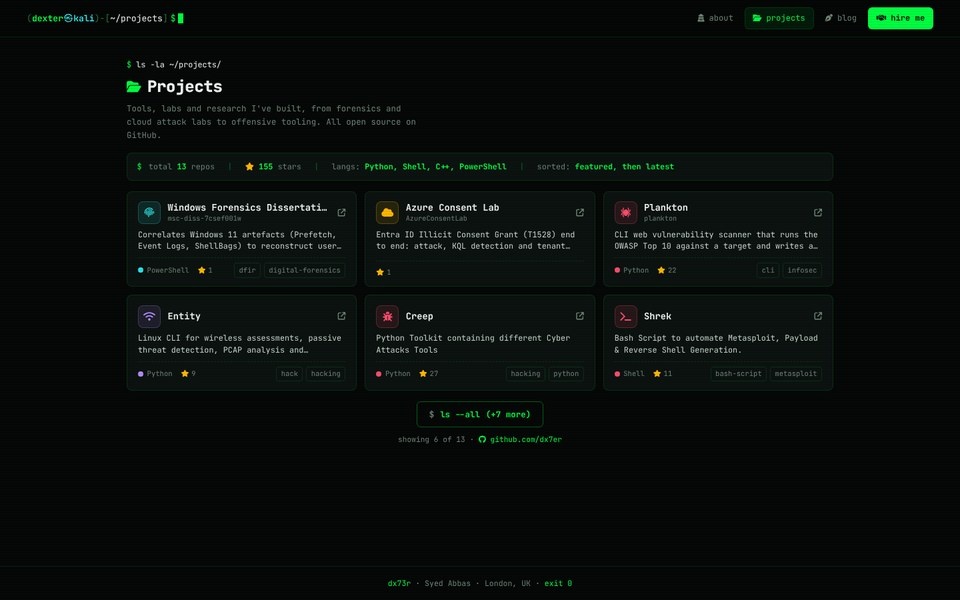
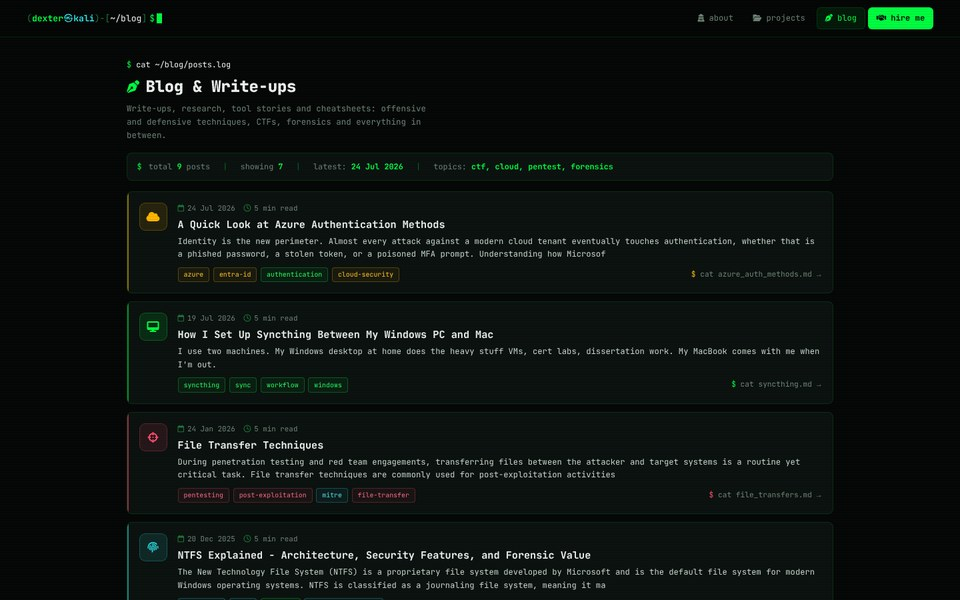
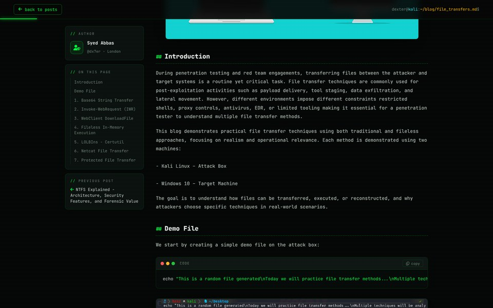
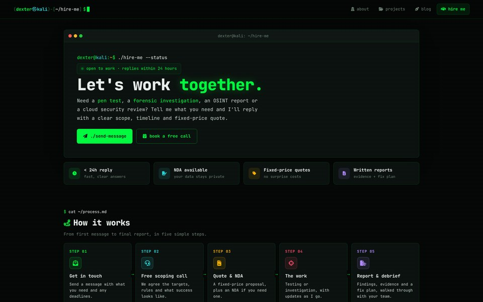
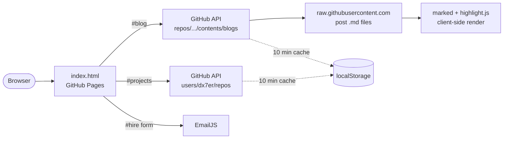

<div align="center">

# dx73r.me

Source code for **[dx73r.me](https://dx73r.me)**, a terminal-themed portfolio and blog built with plain HTML, CSS and JavaScript.

[](https://dx73r.me)


[](LICENSE)



</div>

## Contents

- [dx73r.me](#dx73rme)
  - [Contents](#contents)
  - [Features](#features)
  - [Screenshots](#screenshots)
  - [How it works](#how-it-works)
  - [Getting started](#getting-started)
  - [Project structure](#project-structure)
  - [Adding a blog post](#adding-a-blog-post)
  - [Configuration](#configuration)
  - [Deployment](#deployment)
  - [Dependencies](#dependencies)
  - [Security](#security)
  - [Licence](#licence)

## Features

- **Single file, no build:** the whole site is one `index.html`, with no framework, bundler or package manager.
- **Hash-based routing:** four pages (`#about`, `#projects`, `#blog`, `#hire`) in one document. Legacy `#contact` links redirect to `#hire`.
- **Self-updating projects:** the Projects page reads public repositories from the GitHub REST API. New repos appear automatically, and forks are filtered out.
- **Markdown blog:** posts are `.md` files in `blogs/`, fetched and rendered in the browser with front matter for title, date, tags and excerpt.
- **Rich post reader:** syntax-highlighted code blocks with copy buttons, GitHub-style callouts, image captions, responsive tables, task lists, an auto-generated table of contents and a reading progress bar.
- **Resilient loading:** API responses are cached in `localStorage` for 10 minutes. There are fallbacks for rate limits and network failures, so pages are never blank.
- **Contact form:** delivered through EmailJS, with no backend.
- **Accessible motion:** typing and reveal animations are switched off when the visitor has `prefers-reduced-motion` set.
- **Responsive:** layouts adapt from wide desktop screens down to phones.

## Screenshots

<table>
  <tr>
    <td width="50%"><p align="center"><sub><b>Projects</b>: loaded from the GitHub API</sub></p></td>
    <td width="50%"><p align="center"><sub><b>Blog</b>: generated from <code>blogs/*.md</code></sub></p></td>
  </tr>
  <tr>
    <td width="50%"><p align="center"><sub><b>Post reader</b>: table of contents, code blocks, figures</sub></p></td>
    <td width="50%"><p align="center"><sub><b>Hire Me</b>: process and EmailJS form</sub></p></td>
  </tr>
</table>

## How it works



| Concern | Approach |
|:--|:--|
| Routing | `hashchange` listener shows one `<main class="view">` at a time and updates the title and nav state |
| Lazy loading | Projects and Blog only fetch data the first time their page is opened |
| Rate limits | Unauthenticated GitHub API use is limited to 60 requests an hour per IP. The 10-minute cache keeps normal use far below that |
| Failure handling | Projects falls back to a built-in `BACKUP` list. Blog falls back to the last cached posts, then a link to the `blogs/` folder |
| Scoping | Each page's script is wrapped in its own module (`window.Projects`, `window.Blog`) to avoid name clashes |

## Getting started

**Requirements:** any modern browser and a static file server.

```bash
git clone https://github.com/dx7er/dx7er.github.io.git
cd dx7er.github.io
python3 -m http.server 8000
```

Open <http://localhost:8000>.

> [!NOTE]
> Use a local server rather than opening the file directly. Some browsers restrict `fetch` requests from `file://` pages.

## Project structure

```text
.
├── index.html            # the site: markup, styles and scripts
├── blogs/                # Markdown posts (one file per post)
├── assets/               # images used by posts, plus preview-*.jpg screenshots for this README
├── CNAME                 # custom domain for GitHub Pages
├── .nojekyll             # serve files as-is, without Jekyll
├── SECURITY.md           # vulnerability reporting policy
├── LICENSE
└── style.css             # legacy stylesheet, not used by index.html
```

## Adding a blog post

1. Create a Markdown file in `blogs/`, for example `blogs/ntfs-deleted-files.md`.
2. Add front matter at the top:

   ```markdown
   ---
   title: Tracing a Deleted File Through NTFS
   date: 2026-11-01
   tags: [forensics, dfir, ntfs]
   excerpt: One or two lines shown on the blog list.
   ---
   ```

3. Write the post, then commit and push to `main`. It appears on the site within a minute.

<details>
<summary><b>Supported Markdown</b></summary>

<br>

| Feature | Syntax |
|:--|:--|
| Callouts | `> [!NOTE]`, `> [!TIP]`, `> [!IMPORTANT]`, `> [!WARNING]`, `> [!CAUTION]` |
| Figure with caption | `` |
| Code block | <code>```bash</code> … <code>```</code>, with any language highlight.js supports |
| Table | GitHub-flavoured Markdown tables. They scroll sideways on small screens |
| Task list | `- [x] done` / `- [ ] to do` |
| Table of contents | Built automatically from `##` headings |

**Notes**

- `title` must not start with `[` or be wrapped in quotes, because the front matter parser treats `[` as a list.
- The first `#` heading is hidden in the reader, because the title is already shown above the post.
- Posts are sorted by `date`, newest first.
- Relative image paths (`../assets/...`) are rewritten to raw GitHub URLs.
- Tags decide the card colour (see `TAG_CAT` under [Configuration](#configuration)).

</details>

## Configuration

All settings live in `index.html`, in clearly labelled blocks:

| Search for | Setting | Purpose |
|:--|:--|:--|
| `COLOURS` | CSS custom properties | Site-wide palette |
| `FEATURED` | Array of repos | Repos shown first on Projects, with optional title, description, icon and colour |
| `HIDE` | Array of repo names | Repos never shown (forks are always hidden) |
| `SHOW_FIRST` | Number | Cards shown before the `ls --all` button |
| `BACKUP` | Array of repos | Offline fallback for the Projects page |
| `REPO`, `BRANCH`, `BLOGS_DIR` | Strings | Where blog posts are read from |
| `TAG_CAT` | Object | Maps tags to topics: pentest, forensics, ctf, osint, cloud, malware, research |
| `EMAILJS SETTINGS` | Keys | EmailJS public key, service ID and template ID |

## Deployment

The site is deployed by **GitHub Pages** from the `main` branch root:

1. **Settings → Pages → Source:** `Deploy from a branch`, branch `main`, folder `/ (root)`.
2. `CNAME` holds the custom domain, and `.nojekyll` makes sure files are served without Jekyll processing.
3. Every push to `main` is live in about a minute.

## Dependencies

All are loaded from CDNs at runtime, so nothing needs installing:

| Library | Version | Used for |
|:--|:--|:--|
| [marked](https://marked.js.org/) | 9.1.6 | Markdown parsing |
| [highlight.js](https://highlightjs.org/) | 11.9.0 | Syntax highlighting |
| [EmailJS](https://www.emailjs.com/) | 3.2.0 | Contact form delivery |
| [Font Awesome](https://fontawesome.com/) | 6.5.0 | Icons |
| [JetBrains Mono](https://www.jetbrains.com/lp/mono/) | Google Fonts | Typeface |

## Security

Please report vulnerabilities privately, as described in [`SECURITY.md`](SECURITY.md), rather than opening a public issue.

## Licence

Code is released under the [MIT licence](LICENSE). Blog posts, images and other written content are © Syed Abbas and may not be republished without permission.
