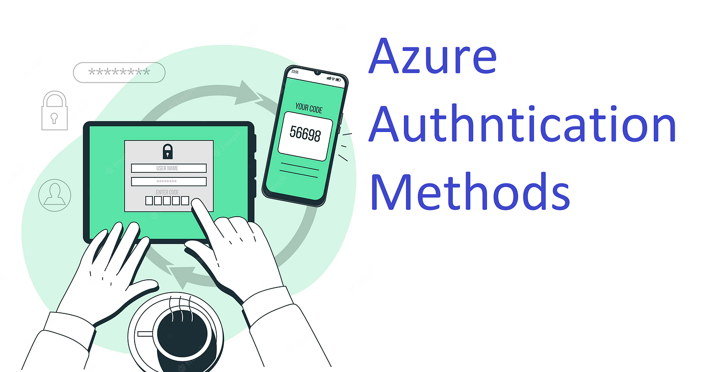

## Introduction

Identity is the new perimeter. Almost every attack against a modern cloud tenant eventually touches authentication, whether that is a phished password, a stolen token, or a poisoned MFA prompt. Understanding how Microsoft Entra ID (formerly Azure AD) authenticates users is the first control an attacker meets and the first control a defender designs.

This blog is a working guide to the most widely used Azure authentication methods, why each exists, and how they compare from a security standpoint.

---

## 1. Password Authentication

The default and the weakest. Users sign in with a username and password validated against Entra ID, or synchronised from on-premises Active Directory through Microsoft Entra Connect using password hash sync, pass-through authentication, or federation.

Passwords remain the most common initial access vector. Even with strong policies they are vulnerable to phishing, password spraying, and credential stuffing. Microsoft treats password-only sign-in as the baseline to move away from.

**Self-Service Password Reset (SSPR)** lets users reset their own password after proving identity through a second factor, but only strengthens the account if that second factor is itself strong.

---

## 2. Multi-Factor Authentication (MFA)

MFA requires the user to prove identity with more than one factor: something they know, something they have, or something they are. Enabling it blocks the overwhelming majority of automated identity attacks.

Supported second factors in Entra ID include the Microsoft Authenticator app (push, TOTP, passwordless phone sign-in), SMS or voice call, OATH hardware tokens, FIDO2 security keys, Windows Hello for Business, and certificate-based authentication.

SMS and voice are the weakest options because of SIM swap and interception attacks. They are better than nothing, but modern deployments push users toward the Authenticator app or phishing-resistant methods.

---

## 3. Microsoft Authenticator App

The most deployed MFA method in Entra ID. It supports three modes:

| Mode | How it works | Notes |
|---|---|---|
| Push notification | User approves a prompt on their phone | Vulnerable to MFA fatigue without number matching |
| TOTP code | 6-digit rolling code | Works offline |
| Passwordless phone sign-in | Full sign-in from the app | Requires device registration |

Number matching is now enforced by default. The user must type a number shown on the sign-in screen into the app, which stops accidental or coerced approvals during push-bombing.

---

## 4. FIDO2 Security Keys

FIDO2 is the phishing-resistant standard built on WebAuthn and CTAP2. A hardware key (YubiKey, Feitian, Token2) stores a private key and signs a challenge tied to the site's origin, so a stolen credential is useless without physical possession of the key plus its PIN or biometric.

FIDO2 defeats phishing (credentials are bound to the origin), adversary-in-the-middle proxy attacks such as Evilginx, and credential replay. Entra ID supports FIDO2 for both cloud-only and hybrid users, and it can be used as a first factor for fully passwordless sign-in.

---

## 5. Windows Hello for Business

Windows Hello for Business replaces the password on Windows devices with a PIN, fingerprint, or facial recognition bound to the local TPM. The credential never leaves the device and cannot be extracted through common credential-dumping techniques such as Mimikatz against LSASS.

Deployment models include cloud Kerberos trust, key trust, and certificate trust. Cloud Kerberos trust is the recommended path for most environments because it removes the on-premises PKI requirement while still allowing on-prem resource access.

From an attacker's view, Windows Hello forces a shift toward token theft and session hijacking rather than password extraction.

---

## 6. Certificate-Based Authentication (CBA)

Entra ID Certificate-Based Authentication lets users sign in directly with an X.509 certificate issued by a trusted CA, without federation. It is phishing-resistant and useful for regulated environments (government, defence, healthcare) that already run internal PKI.

Setup involves uploading trusted CA certificates to Entra ID, defining authentication binding policies (which certificates count as single-factor or multi-factor), and mapping the certificate to a user account through a field such as PrincipalName or RFC822Name.

---

## 7. Passwordless Sign-In

Passwordless is not a single method. It is the outcome of using Authenticator phone sign-in, FIDO2, Windows Hello, or CBA as the first and only factor. Removing the password removes an entire class of attacks: phishing, spraying, stuffing, and dumping. It is the direction Microsoft and the wider identity industry are actively pushing, and a heavy theme across AZ-500 and SC-300.

---

## 8. Conditional Access, the Enforcement Layer

Authentication methods do not enforce themselves. **Conditional Access** is the policy engine that decides which method is acceptable for which sign-in, based on signals such as user, group, application, device state, location, and risk. A modern baseline looks like this:

- Require MFA for all users
- Require phishing-resistant MFA for admins through Authentication Strengths
- Block legacy authentication protocols
- Require a compliant or hybrid-joined device for sensitive apps
- Elevate requirements when sign-in risk is medium or high (Entra ID Protection)

Without Conditional Access, registered strong methods are optional. With it, they become mandatory in the contexts that matter.

---

## Quick Comparison

| Method | Phishing-resistant | Passwordless capable | Typical use |
|---|---|---|---|
| Password | No | No | Legacy baseline |
| SMS / Voice MFA | No | No | Being deprecated for high-value accounts |
| Authenticator push (with number matching) | Partial | Yes | Broad workforce MFA |
| FIDO2 security key | Yes | Yes | Admins, high-risk users |
| Windows Hello for Business | Yes | Yes | Corporate Windows fleet |
| Certificate-Based Authentication | Yes | Yes | Regulated or PKI-heavy environments |

---

## Conclusion

Azure authentication sits on a spectrum, from weak (password-only) to phishing-resistant (FIDO2, Windows Hello, CBA). The direction of travel is clear: passwordless, hardware-backed, enforced through Conditional Access.

---

##### A supporter is worth a thousand followers! [Buy Me a Coffee](https://www.buymeacoffee.com/dx73r). If you like this blog, follow me on [GitHub](https://github.com/dx73r73r) and [LinkedIn](https://www.linkedin.com/in/dx73r/).
