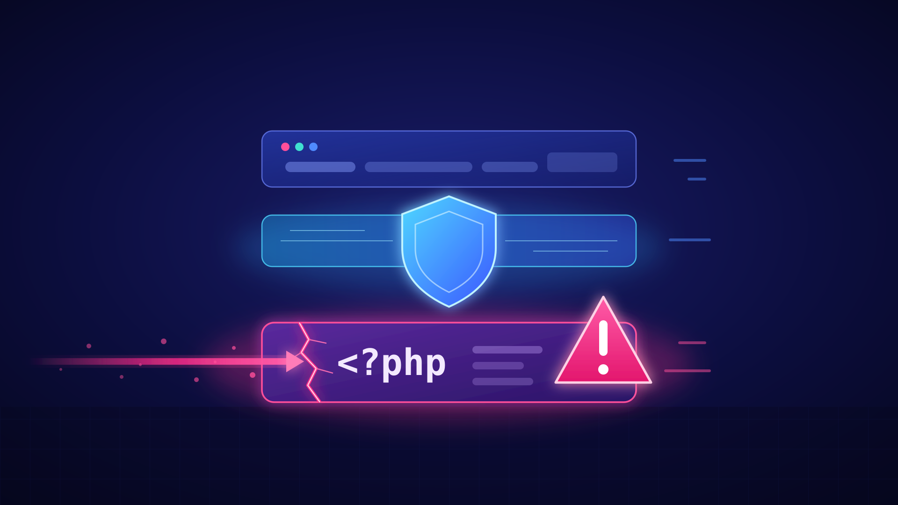
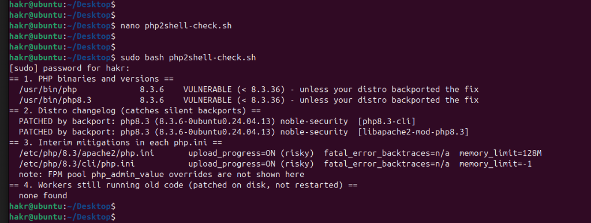
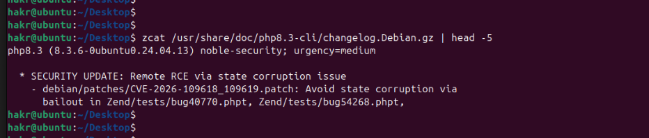
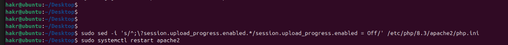
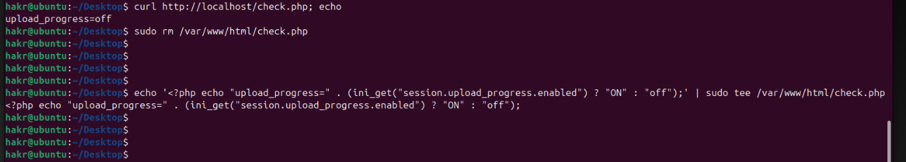
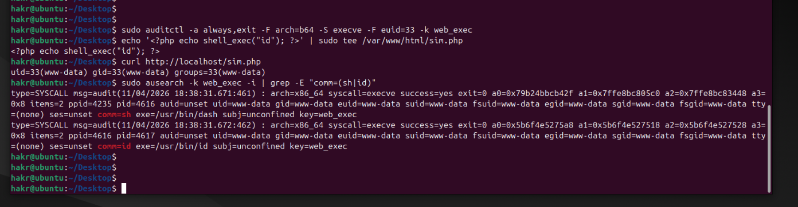

# PHP2Shell - The PHP Core Bug That Ran Before Your Code

> **TL;DR** - In October 2026 PHP pushed emergency fixes for two critical bugs inside the interpreter itself. People started calling them **PHP2Shell** (`CVE-2026-109618` and `CVE-2026-109619`, both **CVSS v4.0 9.2**). They let an unauthenticated attacker run code on web server **before the application even starts running**. Attackers were already trying it four days before patch was out. The fix is simple on paper: upgrade PHP, **restart every worker** and go back through your logs to **17 October 2026**.


## Why This Matters

Most PHP bugs I have looked at lives in an app or a plugin. A WordPress add-on, an old Laravel package, a badly written upload form. You patch the app and move on.

This one is different. The bug sits in **PHP itself**, in the part that reads the incoming HTTP request. That happens before your login page, your input validation or any in-app firewall even gets a look at the request. So "we have authentication" or "our code is clean" doesn't help here.

And PHP is everywhere. Apache `mod_php`, PHP-FPM, `php-cgi`, FrankenPHP and LiteSpeed were all in scope and the flawed code goes back to **PHP 5.4**. Reports at the time put roughly **70% of websites** at risk.

### At a Glance

| | CVE-2026-109618 | CVE-2026-109619 |
|---|---|---|
| **Type** | Memory corruption after an out-of-memory error during request start-up | Use-after-free from state left over between requests |
| **Impact** | Unauthenticated remote code execution | Unauthenticated remote code execution |
| **CVSS v4.0** | **9.2 Critical** | **9.2 Critical** |
| **Vector** | `AV:N/AC:H/AT:P/PR:N/UI:N/VC:H/VI:H/VA:H` | same |
| **Affected** | PHP 5.4 → 8.5.11 | same |
| **Fixed in** | 8.2.35 · 8.3.36 · 8.4.27 · 8.5.12 | same |
| **CISA KEV** | Added 26 Oct 2026 | Added 26 Oct 2026 |

**Reading the score:** `PR:N/UI:N` means no login and no user click is needed. `VC/VI/VA:H` means full loss of confidentiality, integrity and availability. It is 9.2 and not 10 because of `AC:H/AT:P`. A reliable exploit needs the right server setup and lot of effort from attacker. That didn't stop people from trying.


## Part 1 - How It Happened

It moved fast and not really to plan.

| Date (2026) | What happened |
|---|---|
| **17 Oct** | Amazon's threat intelligence saw the first exploitation attempts, four days before any fix |
| **20 Oct** | A post on Hacker News leaked that two PHP RCEs were coming (wrongly claiming CVSS 10.0). One of the research teams accidentally published a proof-of-concept video. PHP brought the release forward |
| **21 Oct, 03:02 UTC** | Cloudflare switched on WAF rules for all customers |
| **21 Oct, 14:00 UTC** | PHP released **8.5.12, 8.4.27, 8.3.36, 8.2.35**, plus source-only backports for 7.4, 8.0 and 8.1 |
| **21 Oct, 14:19 UTC** | watchTowr's honeypots recorded active exploitation attempts, 19 minutes after the patch |
| **22 Oct** | Public PoCs appeared. Rapid7 found each one only worked on a specific OS / PHP / web server combination |
| **23 Oct** | PHP disclosed a related bug, **CVE-2026-115560**. A mitigation was available but no patch yet |
| **26 Oct** | CISA added both CVEs to the Known Exploited Vulnerabilities catalogue, with a 29 Oct deadline for US federal agencies |

Organisations didn't wait to find out. **BambooHR**, several **Dutch government and education** sites and Australia's **cyber.gov.au** were taken offline as a precaution while their teams patched.

The bugs were found by **Wiz Research, Calif and OpenAI's Codex Security team**, working with the PHP security team. Google's Gemini team helped with the fix.


## Part 2 - What Was the Issue?

To understand both bug you need to know two things about how PHP works.

**1. PHP prepares the request before your script runs.** When request arrives PHP first parses the body into `$_POST` and `$_FILES` and handles session upload progress tracking. Only after that does your code start.

```
  HTTP request
       │
       ▼
┌──────────────────────────────┐
│ 1. Request start-up          │ ◄── body parsed into $_POST / $_FILES
│                              │     ★ PHP2Shell lives here
├──────────────────────────────┤
│ 2. Your application runs     │ ◄── auth, validation, filters
├──────────────────────────────┤
│ 3. Request shutdown/cleanup  │
└──────────────────────────────┘
       │
       ▼
  same worker process serves the NEXT request
```

**2. Worker processes are reused.** One `apache2` or `php-fpm` process handles many requests, one after another.

The root cause is the same for both. **A fatal error stops PHP halfway through setting something up, and later code trusts the half-finished result.**

- **CVE-2026-109618** - If PHP runs out of memory (`memory_limit`) while building the request data, it stops midway. The cleanup that runs afterwards treats the incomplete data as valid and memory gets corrupted.
- **CVE-2026-109619** - If a fatal error interrupts cleanup at the end of request, some internal state survives and still points to memory that was already freed. The **next** request on the same worker can then use it. The confirmed paths go through **session upload progress** (on by default, even if the app never calls `session_start()`) and, on PHP 8.5, **fatal error backtraces** (also on by default).

**Who was most at risk?** All the vendor write-ups put **Apache `mod_php`** at the top, because it runs that cleanup even when request start-up fails. PHP-FPM kills the worker when start-up fails, which blocks the main CVE-2026-109618 path. However, FPM is still exposed through CVE-2026-109619.


## Part 3 - How It Was Exploited

From attackers side it looks simple. **One unauthenticated HTTP POST** with crafted form data, sent to any PHP page. No special endpoint, no login. The request pushes PHP into that half-finished state, and with enough preparation the attacker turns it into running commands **as the web server user** (`www-data` on Ubuntu).

In practice it was messy:

- **Attempts before disclosure** were seen by AWS from 17 October.
- **Mass scanning** started within minutes of the patch release.
- **WAF evasion**: Cloudflare reported attackers changing their payloads to get around its new rules.
- **Fragile PoCs**: public exploits were tied to specific builds and setups, and failed attempts often crashed the worker.

The important part for defenders is that **a successful run can look completely normal.** Researchers showed working exploits that returned `HTTP 200` and left the worker alive. So "no crash, no 500 errors" does not mean server was not compromised.

### What It Means on a Real Web Server

If a real production server was running vulnerable PHP with `mod_php`, the attacker would get the same access the web server has. In practice that means:

- reading `.env` and config files, so database passwords, API keys and cloud credentials
- dropping a web shell in the web root, so they can come back later even after the patch is applied
- dumping the database behind the site (customer data, user accounts, orders)
- using the server as a foothold to move to other machines on the internal network

The attacker starts as `www-data` and not as root. However, on most web servers `www-data` can already read everything that matters for the application. Thats why organisations like BambooHR took their services offline instead of waiting.


## Part 4 - Am I Exposed? (Hands-on Check)

Checking `php -v` is not enough, for two reasons:

1. **Distros backport fixes** without changing the version number.
2. **Patched on disk is not patched in memory.** Old workers keep running the vulnerable code until they are restarted.

So I wrote a small **read-only** script that checks four things: version, distro backport, interim mitigations and stale workers.

```bash
#!/usr/bin/env bash
# php2shell-check.sh - read-only exposure check for PHP2Shell
# (CVE-2026-109618 / CVE-2026-109619). Changes nothing on the host.
# Run as root to see every process.

fixed_for() {
  case "$1" in
    8.2) echo 8.2.35 ;; 8.3) echo 8.3.36 ;;
    8.4) echo 8.4.27 ;; 8.5) echo 8.5.12 ;;
    *)   echo none ;;
  esac
}

echo "== 1. PHP binaries and versions =="
bins=$( { compgen -c; ls /usr/sbin /usr/local/sbin 2>/dev/null; } \
        | grep -E '^php(-fpm)?[0-9.]*$' | sort -u )
for b in $bins; do
  path=$(command -v "$b" || ls /usr/sbin/"$b" /usr/local/sbin/"$b" 2>/dev/null | head -1)
  [ -z "$path" ] && continue
  v=$("$path" -v 2>/dev/null | head -1 | awk '{print $2}')
  v=${v%%[-+~]*}                      # strip distro suffix, e.g. 8.1.2-1ubuntu2
  [ -z "$v" ] && continue
  fixed=$(fixed_for "$(echo "$v" | cut -d. -f1,2)")
  if [ "$fixed" = none ]; then
    status="NO UPSTREAM FIX - EOL branch, needs vendor backport or upgrade"
  elif [ "$(printf '%s\n%s\n' "$fixed" "$v" | sort -V | head -1)" = "$fixed" ]; then
    status="OK (>= $fixed)"
  else
    status="VULNERABLE (< $fixed) - unless your distro backported the fix"
  fi
  printf '  %-24s %-8s %s\n' "$path" "$v" "$status"
done

echo "== 2. Distro changelog (catches silent backports) =="
found=0
for f in /usr/share/doc/php*-cli/changelog.Debian.gz /usr/share/doc/php*-fpm/changelog.Debian.gz \
         /usr/share/doc/libapache2-mod-php*/changelog.Debian.gz; do
  [ -e "$f" ] || continue
  if zgrep -qm1 'CVE-2026-109618' "$f"; then
    echo "  PATCHED by backport: $(zcat "$f" | head -1 | cut -d';' -f1)  [$(basename "$(dirname "$f")")]"
    found=1
  fi
done
command -v rpm >/dev/null && rpm -qa 'php*' --changelog 2>/dev/null \
  | grep -qm1 'CVE-2026-109618' && { echo "  fix listed in RPM changelog"; found=1; }
[ $found = 0 ] && echo "  no package changelog mentions the CVE (normal for source/Docker builds)"

echo "== 3. Interim mitigations in each php.ini =="
inis=$(ls /etc/php*/php.ini /etc/php/*/*/php.ini /usr/local/etc/php/php.ini 2>/dev/null)
[ -z "$inis" ] && inis="(built-in defaults)"
for ini in $inis; do
  if [ "$ini" = "(built-in defaults)" ]; then opt="-n"; else opt="-c $ini"; fi
  php $opt -r '
    $u = ini_get("session.upload_progress.enabled");
    $b = ini_get("fatal_error_backtraces");
    printf("  %-34s upload_progress=%s  fatal_error_backtraces=%s  memory_limit=%s\n",
      $argv[1], $u ? "ON (risky)" : "off", $b === false ? "n/a" : ($b ? "ON" : "off"),
      ini_get("memory_limit"));' "$ini" 2>/dev/null
done
echo "  note: FPM pool php_admin_value overrides are not shown here"

echo "== 4. Workers still running old code (patched on disk, not restarted) =="
stale=0
for p in $(pgrep -f 'php-fpm|apache2|httpd|frankenphp|lsphp'); do
  if grep -qE 'php[^ ]* \(deleted\)' /proc/"$p"/maps 2>/dev/null; then
    echo "  PID $p ($(cat /proc/"$p"/comm)) maps a deleted PHP binary - restart it"
    stale=1
  fi
done
[ $stale = 0 ] && echo "  none found"
```

### Testing It on My Server

I ran the script on an Ubuntu 24.04 web server with Apache and `mod_php`, which is the setup vendors rated as highest risk.

**Run 1 - the script raised two red flags.**


*Figure 1: First run. PHP reports 8.3.6, which is below the fixed 8.3.36, and session upload progress is ON in Apache's php.ini*

- **Section 1:** the version string says **8.3.6**. Going by the number alone this server is vulnerable and a basic scanner would flag it.
- **Section 3:** `upload_progress=ON (risky)` in `/etc/php/8.3/apache2/php.ini`. This is the default setting that the CVE-2026-109619 and CVE-2026-115560 paths go through, and it is on the php.ini that serves web traffic.

**Digging deeper.** Section 2 said "PATCHED by backport", so I checked the package changelog myself.


*Figure 2: Ubuntu changelog showing the PHP2Shell patch (CVE-2026-109618_109619.patch) in build 8.3.6-0ubuntu0.24.04.13*

Ubuntu had copied the fix into its own 8.3.6 build without changing the version number. So the core bug was already patched but the risky default was still switched on.

**The fix.** I turned off session upload progress in Apache's php.ini and restarted Apache so the running workers pick up the change:

```bash
sudo sed -i 's/^;\?session.upload_progress.enabled.*/session.upload_progress.enabled = Off/' /etc/php/8.3/apache2/php.ini
sudo systemctl restart apache2
```

**Run 2 - clean.**

*Figure 3: Second run after the fix. Apache's php.ini now shows upload_progress=off*

The CLI php.ini still shows ON. Thats fine, because each SAPI has its own php.ini and the CLI does not serve web requests.

However, changing the file is not the same as the running server using it. So I asked the live web server directly with a small test page and deleted it straight after.


*Figure 4: Live Apache worker reporting upload_progress=off*

**What I took from my own test:**

- **Version strings lie.** Trust the package changelog and not `php -v`. On RHEL-based systems use `rpm -q --changelog php-fpm | grep CVE-2026-109618`.
- **Patched does not mean hardened.** The core fix was there, but the risky default was still on until I changed it.
- **Check the right php.ini.** The one serving web traffic is the one that matters.


## Part 5 - How It Was Detected

No single signal proves exploitation on its own. You have to correlate across three layers.

### 1. Error Logs - the Set-up Phase

The main giveaway is a memory error that ends with **"in Unknown on line 0"**. It means PHP failed **before any script ran** and normal application bugs dont do that.

```bash
# Memory exhausted before any script ran
grep -E "Allowed memory size of [0-9]+ bytes exhausted.* in Unknown on line 0" \
  /var/log/apache2/error.log /var/log/php*-fpm.log

# Worker crashes (failed attempts)
grep -E "AH00052: child pid [0-9]+ exit signal Segmentation fault|exited on signal 11" \
  /var/log/apache2/error.log /var/log/php*-fpm.log
```

On a real server under attack you would see short burst of these. First the memory exhausted errors ending with `in Unknown on line 0`, then Apache child processes dying with a segmentation fault (`AH00052`) or FPM workers exiting on signal 11. A full attack can leave only **two to four** of these and then go quiet, so even a small burst is worth investigating.

### 2. Access Logs - the Probing Phase

```bash
# Repeated .php path segments (used to probe for memory leaks)
grep -E '"[A-Z]+ (/[^/ "]+\.php){3,}' /var/log/apache2/access.log

# Bursts of "OPTIONS *" connections (used to tie up workers), counted per IP
awk '$6=="\"OPTIONS" && $7=="*" {print $1}' /var/log/apache2/access.log | sort | uniq -c | sort -rn
```

Two more signals, if your proxy or WAF logs them:

- **Unusually long `PHPSESSID` values** in `Set-Cookie` responses. Normal IDs are 22–256 characters, so a longer or binary-looking value can mean memory is leaking.
- **Multipart POSTs** with hundreds of parts or deeply nested field names like `files[a][a][a][a]`.

### 3. Process Telemetry - the Payoff

The **strongest signal** is a PHP web worker starting a shell or a download tool. On a real compromised server, the chain usually looks like this:

```
apache2 (www-data) ──► sh -c ... ──► bash ──► outbound connection
```

**Sigma rule:**

```yaml
title: Shell or Download Tool Spawned by PHP Web Worker (Possible PHP2Shell)
id: fba99941-0064-4ca1-b4ba-96a271327bba
status: experimental
description: Detects a PHP web worker starting a shell or network tool, the typical result of PHP2Shell RCE.
references:
  - https://www.cisa.gov/news-events/alerts/2026/10/21/critical-vulnerabilities-php-require-immediate-patching
author: dx73r
date: 2026-11-01
tags:
  - attack.initial-access
  - attack.t1190
  - attack.execution
  - attack.t1059.004
  - cve.2026-109618
  - cve.2026-109619
logsource:
  product: linux
  category: process_creation
detection:
  selection_parent:
    ParentImage|endswith: ['/apache2', '/httpd', '/frankenphp', '/lsphp']
  selection_parent_fpm:
    ParentImage|contains: '/php-fpm'
  selection_child:
    Image|endswith: ['/sh', '/bash', '/dash', '/curl', '/wget', '/nc', '/ncat', '/socat', '/python3', '/perl']
  condition: (selection_parent or selection_parent_fpm) and selection_child
falsepositives:
  - Apps that intentionally call system()/exec() - baseline first
level: high
```

**No SIEM?** One auditd rule logs every command the web user runs (UID 33 is `www-data` on Debian/Ubuntu):

```bash
sudo auditctl -a always,exit -F arch=b64 -S execve -F euid=33 -k web_exec
sudo ausearch -k web_exec -i | grep -E "comm=(sh|bash|curl|wget|nc)"
```

**Testing the detection.** To make sure the rule actually fires I created a one-line test page that runs `id`. This simulates what an attacker does *after* a successful exploit. It is not the exploit itself. Then I requested the page and searched the audit log.


*Figure 5: auditd catching the chain Apache worker (ppid 4235) → sh (pid 4616) → id (pid 4617), all running as www-data*

The web server (`www-data`) started `sh`, which is actually `/usr/bin/dash` on Ubuntu, and that ran `id`. Thats the exact pattern the Sigma rule and KQL query look for. It is also why both include `/dash` and not only `/sh`. On a real compromised server you would not see `id`. You would see `curl`, `wget` or a reverse shell instead.

**Microsoft Defender for Endpoint (KQL):**

```kql
DeviceProcessEvents
| where Timestamp > datetime(2026-10-17)
| where InitiatingProcessFileName in~ ("apache2","httpd","frankenphp","lsphp")
     or InitiatingProcessFileName startswith "php-fpm"
| where FileName in~ ("sh","bash","dash","curl","wget","nc","ncat","socat","python3","perl")
| project Timestamp, DeviceName, InitiatingProcessFileName, FileName, ProcessCommandLine, AccountName
```


## Part 6 - How to Fix It

### Step 1 - Patch

```bash
# Debian / Ubuntu
sudo apt update && sudo apt upgrade
sudo systemctl restart apache2 php8.3-fpm      # use your own versions

# RHEL / Alma / Rocky
sudo dnf upgrade 'php*'
sudo systemctl restart httpd php-fpm

# Docker - bump the base image, rebuild without cache, redeploy
#   FROM php:8.5.12-apache
docker build --pull --no-cache -t myapp .
```

On **Windows / XAMPP**, replace the bundled PHP folder with a fixed build from windows.php.net and restart Apache.

On **PHP 7.4–8.1**, use your vendor's LTS package or PHP's source backport. Better still, move to 8.2+. **PHP 7.3 and older have no fix.**

### Step 2 - Restart Every Worker

This is the step most people misses. Updating the package only changes the files on disk. Running workers still hold the old code in memory until they are restarted. Re-run section 4 of the script to confirm nothing still maps a deleted PHP binary.

### Step 3 - Interim Hardening (If You Can't Patch Today)

These settings **reduce** the risk, they do **not** fix the bugs. Set them in the main `php.ini` or in the FPM pool with `php_admin_value`. **Not** in `.htaccess`, `.user.ini` or `ini_set()`, because those take effect too late. Then restart.

```ini
; CVE-2026-109619 and CVE-2026-115560
session.upload_progress.enabled = 0
fatal_error_backtraces = 0        ; PHP 8.5 only

; CVE-2026-109618 - temporary, revert after patching
memory_limit = -1
post_max_size = 8M
upload_max_filesize = 4M
max_input_nesting_level = 16
max_input_vars = 250
max_file_uploads = 10
```

Also:

- **Cap the request body size** at the proxy (`client_max_body_size 8m;` in nginx).
- **Block multipart uploads** on routes that don't need them.
- Use **cgroup memory limits** (`MemoryMax=`), **not** `ulimit -v` / `RLIMIT_AS`. Those make allocations fail, which is exactly what CVE-2026-109618 needs.
- **Block outbound internet** from web servers. A reverse shell can't call home if egress is closed.
- Keep `session.upload_progress.enabled = 0` **even after patching**, until CVE-2026-115560 gets its own fix.


## Part 7 - If You Think You Were Hit

This is the forensics side, briefly:

1. **Capture memory before restarting** a suspicious host (AVML or LiME). A restart wipes the evidence in memory.
2. **Look for web shells** written since the first known attempts:
   ```bash
   find /var/www -name "*.php" -newermt 2026-10-17 -ls
   ```
3. **Check session files** for staged payloads:
   ```bash
   grep -lE '<\?php|\|O:' /var/lib/php/sessions/* 2>/dev/null
   ```
4. **Review persistence**: new cron jobs, new users, new SSH keys, unknown systemd units.
5. **Rotate secrets** the web user could read: `.env` files, database passwords, API keys, cloud credentials.


## Key Takeaways

- **Core runtime bugs bypass everything above them.** Authentication and app code can't protect something that runs before them.
- **Patch, then restart.** A patch on disk is not a patch in memory.
- **Version strings lie.** Check distro changelog for backports before you panic or close the ticket.
- **Patched is not hardened.** In my own test the fix was there, but the risky default was still on.
- **"HTTP 200, no crash" proves nothing.** Process lineage (web worker → shell) is the best signal.
- **Attackers had a head start.** Hunt back to 17 October, not to the patch date.

## References

1. Rapid7 - [CVE-2026-109618 and CVE-2026-109619: Critical Unauthenticated RCE in PHP](https://www.rapid7.com/blog/post/etr-cve-2026-109618-and-cve-2026-109619-critical-unauthenticated-remote-code-execution-in-php/)
2. Datadog Security Labs - [PHP2Shell: detection, analysis, and remediation](https://securitylabs.datadoghq.com/articles/php2shell-critical-vulnerabilities-in-php/)
3. Google Cloud - [Responding to core PHP vulnerabilities CVE-2026-109618 / CVE-2026-109619](https://cloud.google.com/blog/products/identity-security/responding-to-core-php-vulnerabilities-cve-2026-109618-cve-2026-109619)
4. CISA - [Critical Vulnerabilities in PHP Require Immediate Patching](https://www.cisa.gov/news-events/alerts/2026/10/21/critical-vulnerabilities-php-require-immediate-patching)
5. BleepingComputer - [CISA confirms PHP2Shell vulnerabilities now exploited in attacks](https://bleepingcomputer.com/news/security/cisa-confirms-php2shell-vulnerabilities-now-exploited-in-attacks)
6. BleepingComputer - [Amazon says PHP2Shell exploitation began 4 days before patches](https://bleepingcomputer.com/news/security/amazon-says-php2shell-exploitation-began-4-days-before-patches)
7. The Hacker News - [PHP Issues Emergency Patches for Two Critical PHP2Shell RCE Flaws](https://thehackernews.com/2026/10/php-issues-emergency-patches-for-two.html)
8. The Hacker News - [PHP Warns of Another Unpatched RCE Risk (CVE-2026-115560)](https://thehackernews.com/2026/10/urgent-php-warns-of-another-unpatched.html)
9. watchTowr - [CVE-2026-109618: Exploited Remote Code Execution in PHP (FAQ)](https://watchtowr.com/intelligence/php-cve-2026-109618-faq/)
10. Sophos - [Proof-of-concept exploit released for PHP vulnerabilities](https://www.sophos.com/en-us/blog/proof-of-concept-exploit-released-for-php-vulnerabilities-109618-109619)
11. iTWire - [PHP2Shell: the 14-year-old bugs that pulled cyber.gov.au and government sites offline](https://itwire.com/business-it-news/security/php2shell-the-14-year-old-bugs-that-pulled-cyber-gov-au-and-government-sites-worldwide-offline)
12. Cyber Magazine - [Decade-old Critical PHP2Shell Bugs Put 70% of Websites at Risk](https://cybermagazine.com/news/how-critical-php2shell-bugs-put-70-websites-at-risk)


##### A supporter is worth a thousand followers! [Buy Me a Coffee](https://www.buymeacoffee.com/dx73r). If you like this blog, follow me on [GitHub](https://github.com/dx7er) and [LinkedIn](https://www.linkedin.com/in/dx73r/).
